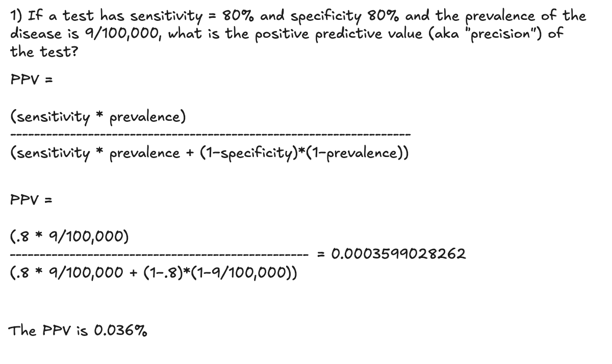
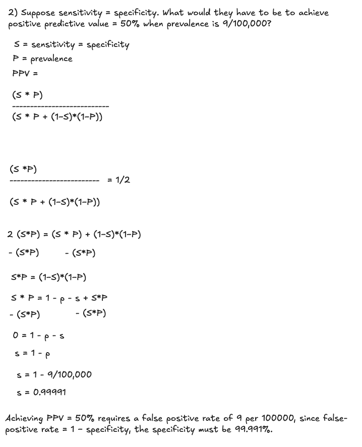
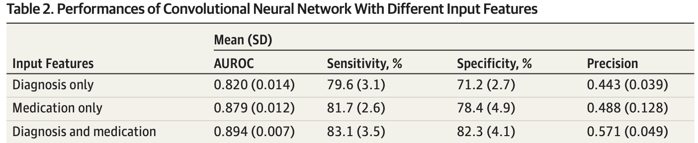
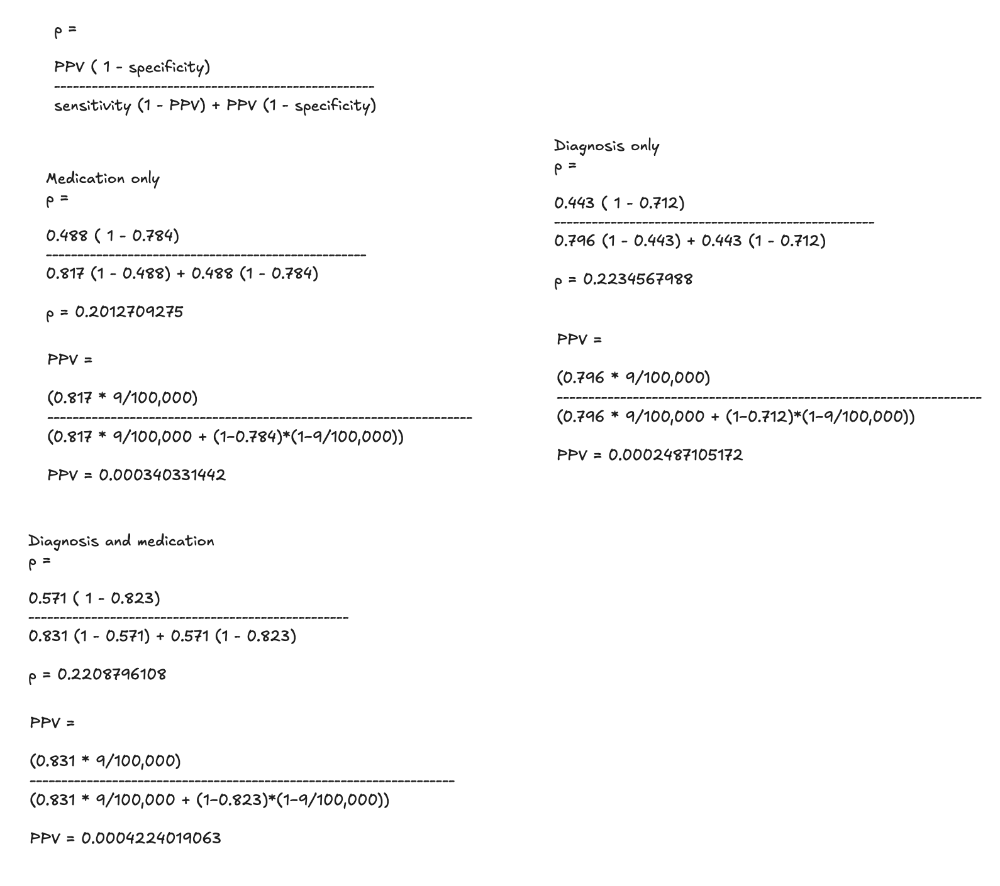

# 1) If a test has sensitivity = 80% and specificity 80% and the prevalence of the disease is 9/100,000, what is the positive predictive value (aka “precision”) of the test?

# 2) Suppose sensitivity = specificity. What would they have to be to achieve positive predictive value = 50% when prevalence is 9/100,000?

# 3) Comment on these results in relation to the precision values provided in Table 2 of Wang et al. (2019).

Table 2 reports precision of 0.443 - 0.571 across the three models. Using the PPV formula, the diagnosis and medication model, with sensitivity 0.831 and specificity 0.823, gets a prevalence of 22.1% (the diagnosis-only and medication-only models get 22.4% and 20.1%).

The recovered p is the prevalence of the data the model was tested on and not the prevalence of a true population. The values of 20% to 22% reflects the composition of the authors test set (which the study built it this way, sampling 1829 cases against 7665 controls at roughly 1:4, 19.3%) The three p's follow that design.

So, the precision column in the table can be seen as an artifact of the sampling design and not an actual property of the model itself when its actually in deployment.

The authors also mention that NMSC occurs in  2.3 to 9.2 per 100,000 for Asian populations. Subsituting  9/100,000 into the PPV forumla, holding the sensitivity and specificity fixed actually gives PPV/precision between 0.00025 and 0.00043 (for each of the models). 

So, seeing these numbers, it further shows that the precision column in the table really overstates the performance on a real population, since, again, the test set was not built to represent one.

